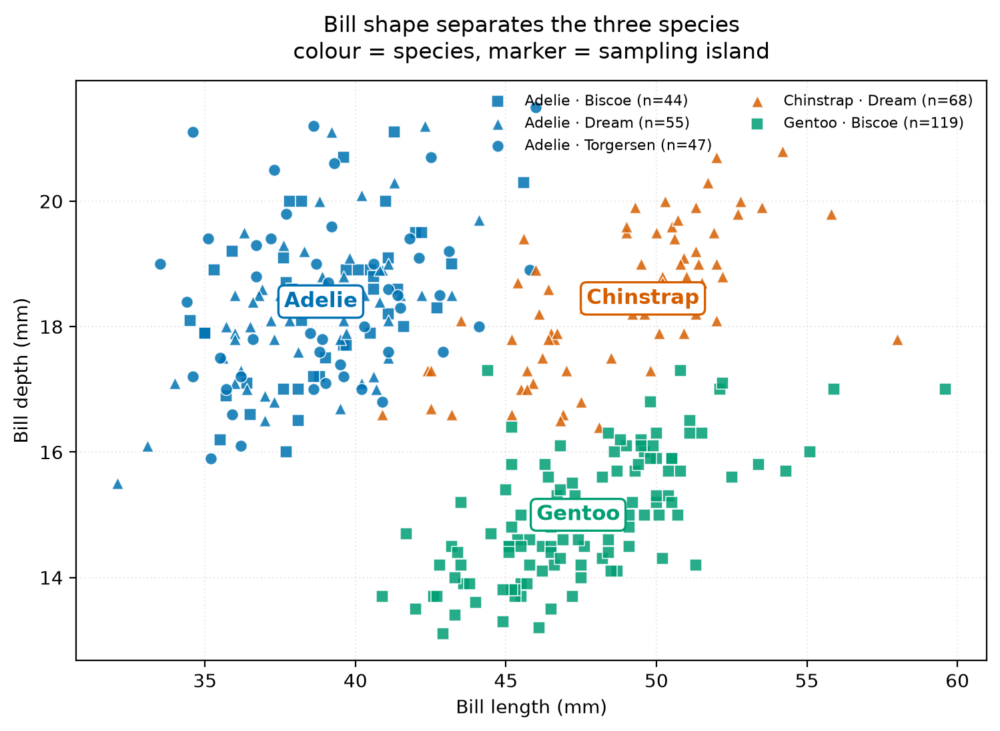
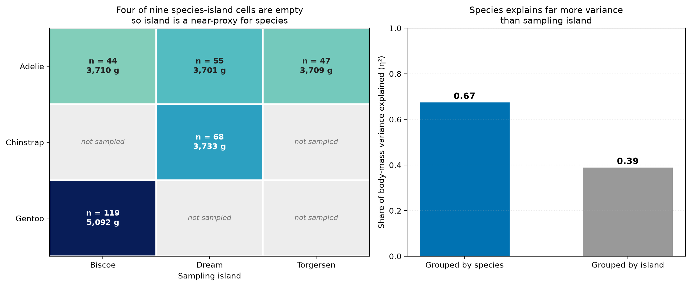

# Peng LongRui

**Data science portfolio** · MSc coursework, CISC7204 Data Visualisation, University of Macau

I turn messy tabular data into figures that answer a specific question — and I try to be honest
about what the data cannot tell me. My current work focuses on exploratory analysis, statistical
testing and interpretable models in Python, with an emphasis on visualisation that survives
scrutiny: colour-blind-safe palettes, labelled sample sizes, and every number traceable to a
script.

---

## Technical skills

| Area | Tools I use |
|---|---|
| **Languages** | Python 3, SQL (basic), Markdown |
| **Data handling** | pandas, NumPy — cleaning, reshaping, joining, missing-value auditing |
| **Statistics** | SciPy — ANOVA, χ², η², effect sizes, confidence intervals |
| **Machine learning** | scikit-learn — random forests, stratified cross-validation, model diagnostics |
| **Visualisation** | Matplotlib, pandas plotting — statistical plots, geospatial maps, typography and colour design |
| **Reproducibility** | Git & GitHub, virtual environments, `requirements.txt`, seeded pipelines |
| **Publishing** | GitHub Pages, Jekyll, Markdown documentation |

---

## Project showcase

### Do penguins get bigger because of the island they live on — or because of their species?

**Research question.** The Palmer Penguins dataset looks like a textbook example of three
cleanly separated species. But Gentoo penguins were only ever sampled on Biscoe island, and
Chinstrap penguins only on Dream. So when the data show that "island matters", is that a real
environmental effect, or is island just a stand-in for species? This project quantifies how much
of the variation in body size is explained by **species** versus by **sampling island**.

*Figure 1 — Bill shape separates the species almost perfectly. Colour encodes species, marker
shape encodes island: note that Gentoo (green) appears in squares only, i.e. only on Biscoe.*

**What the analysis found.**

- The species are genuinely separable: bill shape alone explains **71 %** of bill-length
  variance (one-way ANOVA, F = 397, p < 0.001), and a random forest predicts species from four
  measurements with **97.0 % ± 2.3 %** cross-validated accuracy.
- Island is mostly a proxy for species: species explains **67 %** of body-mass variance, but
  island only **39 %**. Four of the nine species × island cells are structurally empty.
- The decisive test is within a single species. Adelie penguins live on all three islands and
  weigh 3,710 g / 3,701 g / 3,709 g on Biscoe / Dream / Torgersen — island explains
  **0.01 %** of their variance (p = 0.995). The "island effect" in the full dataset is really
  the Gentoo effect in disguise.

*Figure 2 — Left: the sampling design, with the empty cells that create the confounding.
Right: share of body-mass variance explained by species versus island.*

**Status:** ✅ Completed — analysis, figures and documentation finished.

**Code and full write-up:** [github.com/{{ site.github.owner_name }}/data-science-project](https://github.com/{{ site.github.owner_name }}/data-science-project)

Dataset: Palmer Archipelago penguin data, CC0 1.0 public domain, courtesy of the Palmer
Station LTER and the `palmerpenguins` authors. All code released under the MIT licence.

---

## What I am improving next

1. **Notebook version of the analysis.** The pipeline currently lives in one script; I want an
   annotated `.ipynb` alongside it so a reader can follow the reasoning cell by cell.
2. **A second, messier project.** This dataset arrives almost pre-cleaned. My next project uses
   raw open data that needs joining across sources and heavier missing-data decisions.
3. **Model interpretation beyond feature importance.** Permutation importance and partial
   dependence plots, because impurity-based importance can inflate correlated features.

---

## Contact

- GitHub: [github.com/{{ site.github.owner_name }}](https://github.com/{{ site.github.owner_name }})
- Project repository: [data-science-project](https://github.com/{{ site.github.owner_name }}/data-science-project)

Built with GitHub Pages and Jekyll. Portfolio content reviewed for public release: no
personal data, no credentials, no restricted datasets.
